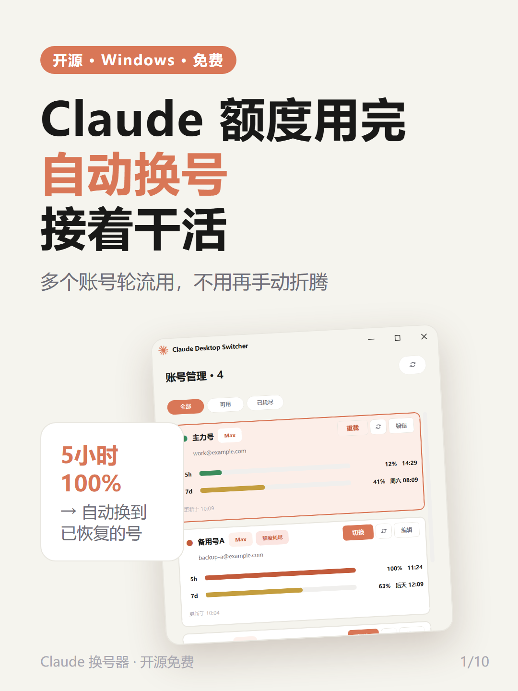
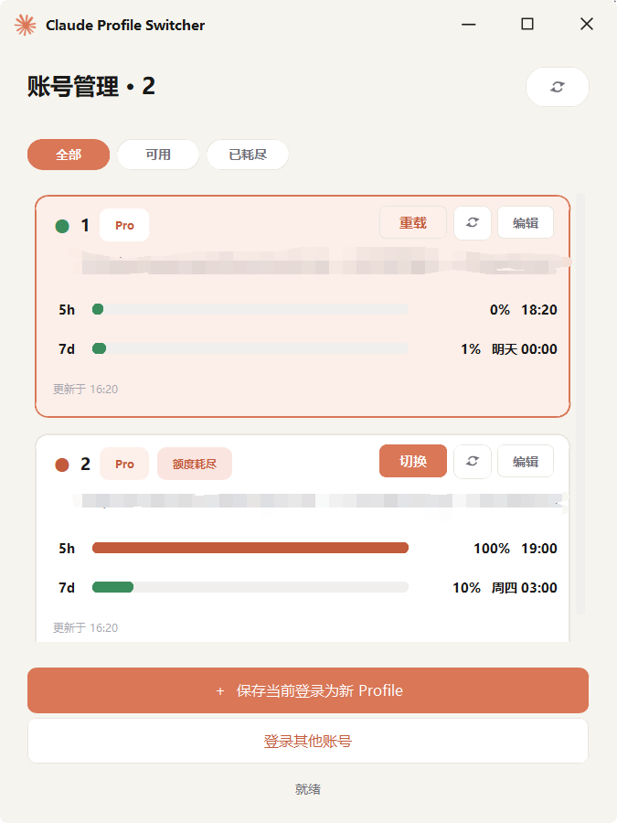
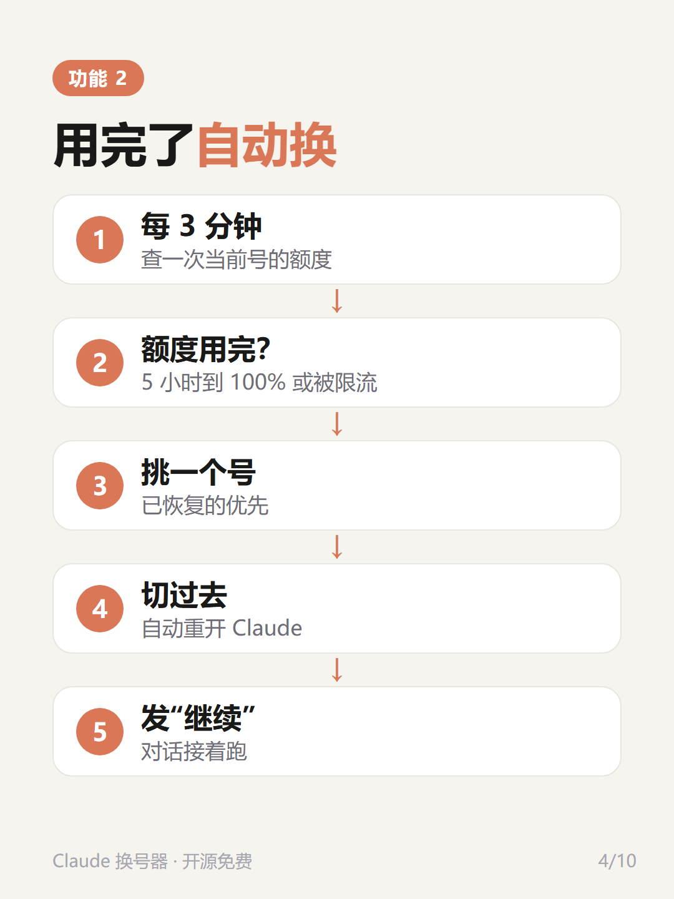
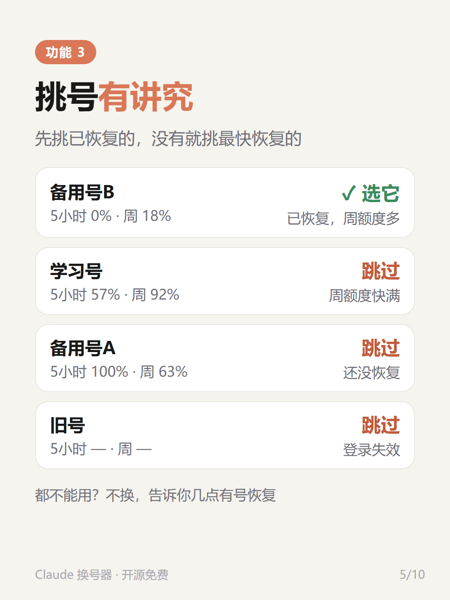
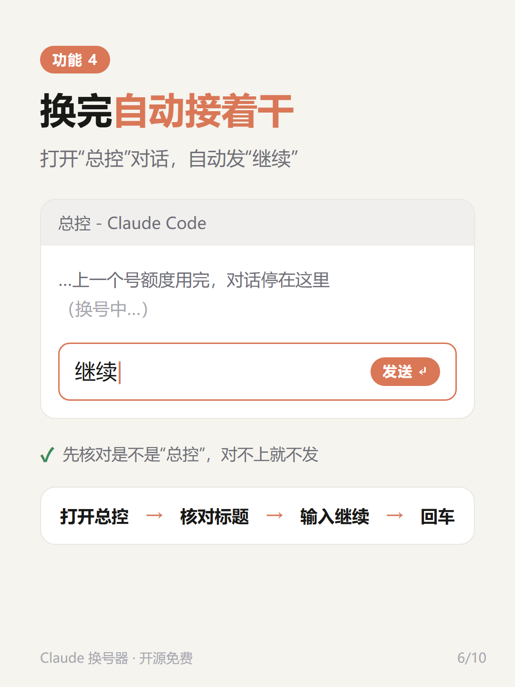
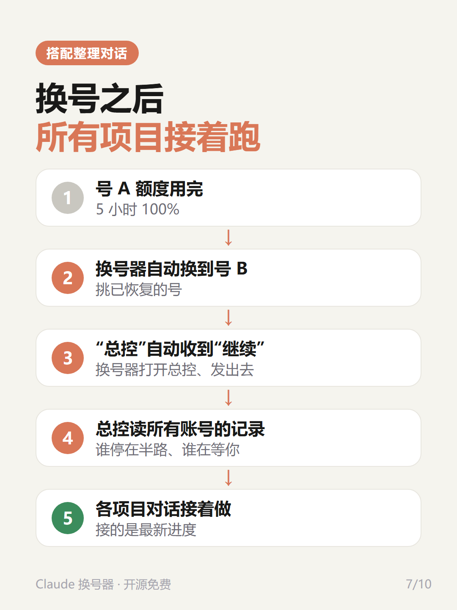
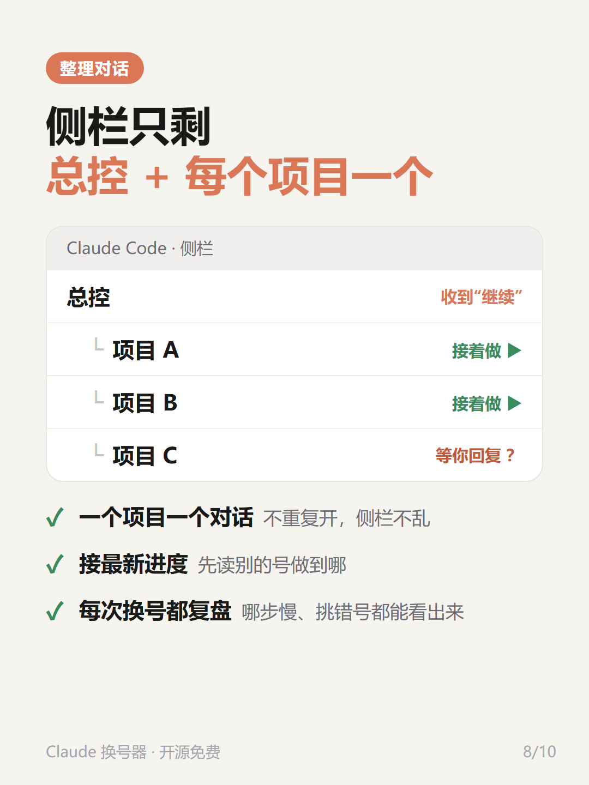
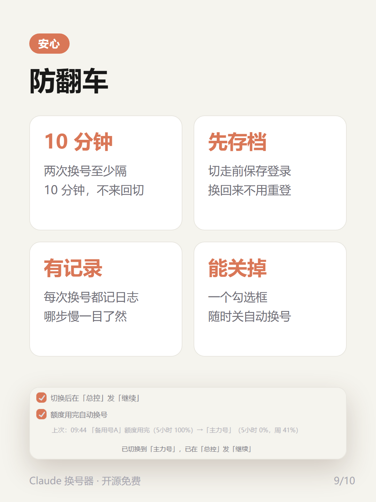

# Claude Desktop Switcher · 额度用完自动换号

[中文](#中文) · [English](#english)

> Windows 桌面工具：Claude Desktop 多账号一键切换、实时看用量，**5 小时额度用完自动换到已恢复的号，可选自动在指定对话里发“继续”（默认关）**。


<p align="center"> </p>

> 本项目 fork 自 [Picadoo/claude-desktop-switcher](https://github.com/Picadoo/claude-desktop-switcher)（MIT），在它的基础上加了自动换号、自动“继续”、换号记录等功能。第三方工具，不是 Anthropic 官方软件。

---

## 中文

### 新增功能（相对上游）

| | |
|---|---|
| 🔁 **额度用完自动换号** | 后台每 3 分钟查一次当前号；5 小时额度用完（或被限流）就自动换号。界面上一个勾选框，随时可关 |
| 🎯 **挑号有讲究** | 已恢复的号优先（周额度剩得多的先）；没有就挑最快恢复的；跳过登录失效、周额度用完（≥95% 就算）、2 小时内切换失败过的号；一个能用的都没有就不换，并提示几点有号恢复 |
| ▶️ **换完自动发“继续”（可选，默认关）** | 自动接着跑很费额度，要用就在界面勾上。切换后用 Windows UI 自动化打开标题为“总控”的 Claude Code 对话，核对标题和输入框后输入“继续”并回车；核对不上就不发 |
| 🛡️ **防翻车** | 两次换号至少隔 10 分钟（手动切换也算），不来回切；切走前先存档登录；正常退出 Claude，不掉登录；设备标识冲突（两个号被互相踢下线）自动重置 |
| 📝 **每次换号都有记录** | `~/.claude-instances/_switch_history.jsonl` 记下每一步花了几秒、新号预计和实际用量、“继续”有没有发出，并自动标出问题，方便复盘优化 |

上游原有：多账号一键切换、实时 5h / 7d 用量、恢复时间、状态灯、筛选、托盘常驻、单实例、5 小时窗口预热。

### 截图

<p align="center">
  
</p>

<p align="center">
  
</p>

<p align="center"></p>

截图里的账号和用量都是演示数据（`scripts/demo_screenshots.py` 生成）。

### 搭配“整理对话”：换号后所有项目自动接着跑

换号器只负责“换号 + 在总控里发继续”。真正让项目接着干的，是 `workspace-template/` 里的**整理对话**规则和工具，两样配着用：

```
号 A 额度用完 → 换号器换到号 B → 在“总控”对话发“继续”
   → 总控跑 sessions_status.py，读本机所有账号的对话记录
   → 找出中断 / 等你回复的项目 → 给每个项目对话发“继续”+ 最新进度 → 各项目接着做
```

关键在于：同一台电脑上所有账号的 Claude Code 对话记录都在 `~/.claude/projects/` 里，新号能直接读到旧号做到哪。

| 文件 | 作用 |
|---|---|
| `workspace-template/CLAUDE.md` | 规则：收到“继续”怎么做；侧栏只留“总控”+ 每个项目一个对话；能复用就不新开；必须接最新进度；每次换号复盘 |
| `workspace-template/HANDOFF.md`、`handoff/` | 项目索引和交接（只记对话里不好找的东西） |
| `workspace-template/_tools/sessions_status.py` | 列出最近的对话，标出 中断 / 等用户 / 完成，附第一句、最后说的话 |
| `workspace-template/_tools/recent_requests.py` | 按关键词查你最近说过什么 |

**怎么配：**

1. 把 `workspace-template/` 里的东西复制到你的工作文件夹根目录（如 `D:\work`），把 `HANDOFF.md` 里的示例项目换成你的
2. 在 Claude 桌面版 Code 里用这个文件夹开一个对话，发“继续”，它会把自己改名为“总控”；之后每个项目都由总控开子对话
3. 换号器设置里把 `folder` 设成这个文件夹（见下面“设置”），这样还没有总控的号也会在这里新开一个发“继续”

### 安装

**最简单**：到 [Releases](../../releases) 下载 `ClaudeDesktopSwitcher.exe`，双击就能用，不用装 Python。

**从源码跑**（Windows + Python 3.10+）：

```bash
git clone https://github.com/cdh66666/claude-desktop-switcher.git
cd claude-desktop-switcher
pip install -r requirements.txt
pythonw claude_switcher.py
```

或双击 `scripts\安装依赖.bat` → `scripts\启动.bat`。想要单个 exe：双击 `scripts\build.bat`（产物在 `dist\`）。

### 首次使用

1. 在 Claude Desktop 登录第 1 个账号
2. 打开换号器，点「＋ 保存当前登录为新 Profile」
3. 点「登录其他账号」→ 登录第 2 个账号 → 再点保存；更多账号同理
4. 勾上「额度用完自动换号」。想换完自动接着干，把要接着跑的 Claude Code 对话改名为「总控」，并勾上「切换后在「总控」发「继续」」

⚠️ 不要在 Claude Desktop 里点“退出登录”，那会让服务器吊销这个号的登录；只用换号器切换。

### 设置

`~/.claude-instances/_settings.json`：

| 键 | 默认 | 说明 |
|---|---|---|
| `auto_switch` | `true` | 额度用完自动换号 |
| `auto_continue` | `false` | 切换后自动发消息 |
| `session_title` | `"总控"` | 发到哪个标题的对话 |
| `text` | `"继续"` | 发什么 |
| `folder` | `""` | 只认这个文件夹里的对话；找不到对话时在这里新开一个（留空 = 不限、不新开） |

### 工作原理

- **切换**：Claude Desktop 的登录状态在 `%APPDATA%\Claude\` 下（`config.json`、`Local Storage`、`Network` 等）。换号器把这些文件按账号存到 `~/.claude-instances/<名字>/`，切换时正常关掉 Claude、交换文件、再打开。
- **用量**：用 Windows DPAPI + AES-GCM 解密本地 OAuth 令牌，向 `api.anthropic.com` 发一个 1 token 的请求，从响应头读 5 小时 / 7 天用量和恢复时间。
- **自动换号**：只查当前号（它本来就在用，不会提前开启别的号的 5 小时窗口）；别的号用缓存，过了恢复时间就当已恢复。挑号、防抖逻辑在 `auto_switch.py`，有单元测试。
- **自动“继续”**：`auto_continue.ps1` 用 UI Automation 找到对话、核对后再输入，测试里用假界面验证“核对不上绝不打字、绝不回车”。

### 测试

```bash
python -m unittest discover -s tests
```

### 风险提示

- 这是第三方工具，靠读写 Claude Desktop 的本地文件工作，Claude 更新后可能失效
- 用量查询和自动换号会定期发极小的 API 请求；多账号轮换是否符合规则，请自己阅读并遵守 [Anthropic 使用条款](https://www.anthropic.com/legal/consumer-terms)，账号风险自负
- `~/.claude-instances/` 里是各账号的登录会话，别发给别人、别提交到 Git；备注是明文，别写密码
- 切换会关掉 Claude，正在跑的对话会被打断（记录还在，发“继续”能接上）

### 致谢

- [Picadoo/claude-desktop-switcher](https://github.com/Picadoo/claude-desktop-switcher)：本项目的上游（界面、切换、用量监控）
- [NeezerGu/claude-profile-switcher](https://github.com/NeezerGu/claude-profile-switcher)：上游的灵感来源（PowerShell 版）

### License

MIT

---

## English

A fork of [Picadoo/claude-desktop-switcher](https://github.com/Picadoo/claude-desktop-switcher) (MIT) — a Windows tool to switch between multiple Claude Desktop accounts with live usage monitoring. This fork adds:

- **Auto-switch when the 5-hour limit is used up** — checks the current account every 3 minutes; when it's full (or rate-limited) it switches to the best account: already-recovered ones first (lowest weekly usage), otherwise the one that recovers soonest. Skips accounts with invalid logins, exhausted weekly limits, or a failed switch in the last 2 hours. If none are usable it stays put and shows when the next one recovers. 10-minute cooldown between switches. One checkbox to turn it off.
- **Auto "continue"** — after switching, opens the Claude Code session titled `总控` (configurable) via UI Automation, verifies the title and input box, then types `继续` (configurable) and presses Enter. Never types if verification fails.
- **Switch history** — every switch is logged to `~/.claude-instances/_switch_history.jsonl` with per-step timings, expected vs. actual usage of the new account, and auto-flagged problems.
- **Workspace relay template** (`workspace-template/`) — a `CLAUDE.md` rule set plus `_tools/sessions_status.py`. All accounts on one PC share `~/.claude/projects/`, so after a switch the "总控" (control) session reads every account's transcripts, finds interrupted / waiting projects, and sends each project session "继续" with the latest progress. Copy the folder's contents into your workspace root and set `folder` in the settings to that path.
- Graceful Claude shutdown (no lost logins) and automatic device-ID reset when two profiles share one.

Install: download `ClaudeDesktopSwitcher.exe` from [Releases](../../releases), or `pip install -r requirements.txt` then `pythonw claude_switcher.py`. Tests: `python -m unittest discover -s tests`. Settings live in `~/.claude-instances/_settings.json` (see table above).

Unofficial third-party tool. Read and follow Anthropic's terms; use at your own risk. MIT licensed.
